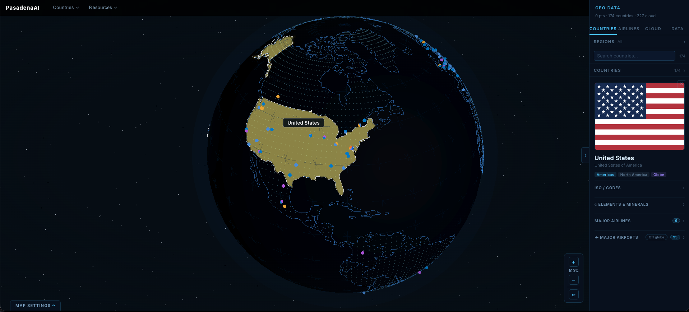
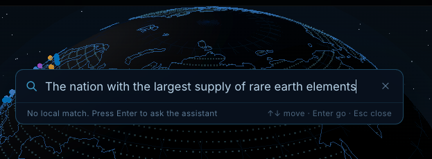
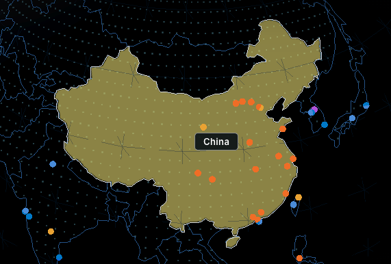
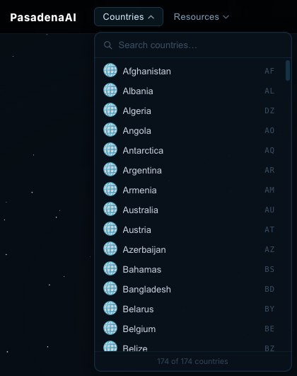
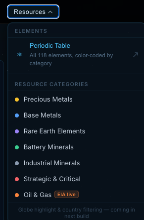
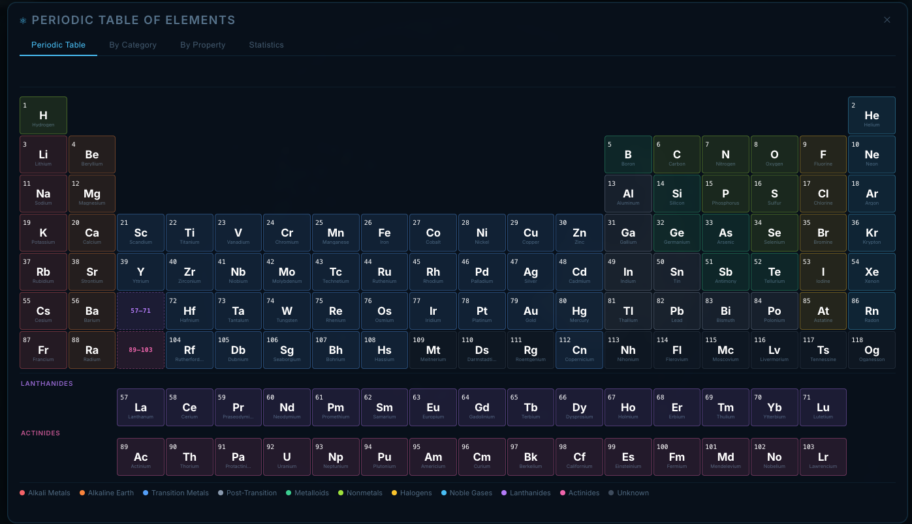
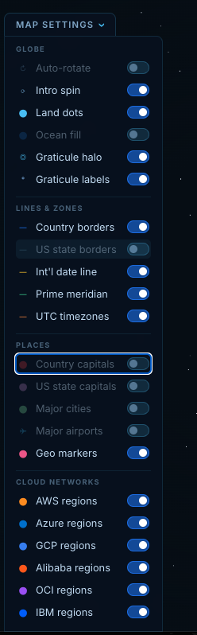
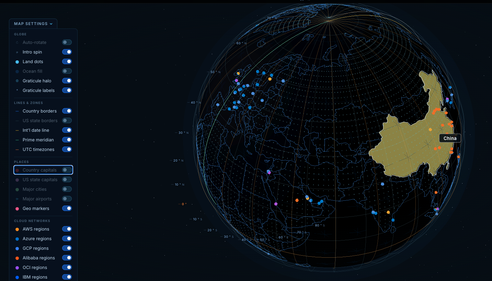

# mindmap-geo-v2

Co-Authors: [Gene Rhim](https://www.linkedin.com/in/generhim) (a.k.a. [pasadena.ai](https://www.github.com/pasadenaai)), & Claude Code. 

Description: Clean, history-free successor to `mindmap-geo` (see `CHANGELOG.md`). Deployed shape: S3 static frontend + API Gateway → Lambda (FastAPI) → DynamoDB. No ECS/Fargate.

Interactive Three.js dot-globe geographic visualisation service.
React/Vite frontend + FastAPI backend + DynamoDB. Intended to integrate into mindmap-app-v3.



## Objective
To create a visual "delimiter" by constraining information into an interactive 3D Globe. 

### Search
Search requires an API call to the FastAPI lambda tucked behind an API Gateway endpoint. The administration of the search runs using an Anthropic API call. <br/>


Any search that can be achieved will turn the globe. <br/>


## Top Menu
### Countries


### Natural Resources




## Bottom Menu - Map Settings




## Quick start (local)

```bash
scripts/dev_env_init.sh   # one-time: generates a git-ignored .env.local with random secrets
docker compose --env-file .env.local -f docker-compose.local.yaml up -d --build
```

| Service | URL |
|---|---|
| Frontend | http://localhost:4203 |
| Backend | http://localhost:8004 |
| API docs | http://localhost:8004/docs |
| DynamoDB Admin | http://localhost:8005 |

Local DynamoDB data is persisted in `./geo_localstack_data/` and survives `docker compose down`.
To wipe: `rm -rf geo_localstack_data/state/`

## Data sync (local ↔ AWS)

Requires AWS credentials in environment or `~/.aws/credentials` with the `pai-geo-seed` IAM policy.

```bash
# Push all tables from local → AWS
python scripts/sync_to_aws.py

# Push specific tables only
python scripts/sync_to_aws.py --tables geo_countries geo_elements geo_country_elements

# Pull from AWS → local (debug with prod data)
python scripts/sync_to_aws.py --direction aws-to-local

# Dry run — print item counts without writing anything
python scripts/sync_to_aws.py --dry-run
```

## AWS deployment

URLs (from the CDK stack outputs — account and API IDs are not stored in this repo):

| Resource | URL |
|---|---|
| Site | https://exploror.labs.pasadena.ai/ |
| API | https://exploror.labs.pasadena.ai/api/ (same origin) |

See `CLAUDE.md` for full deploy and update commands, and `ENV.md` for how secrets are handled.
